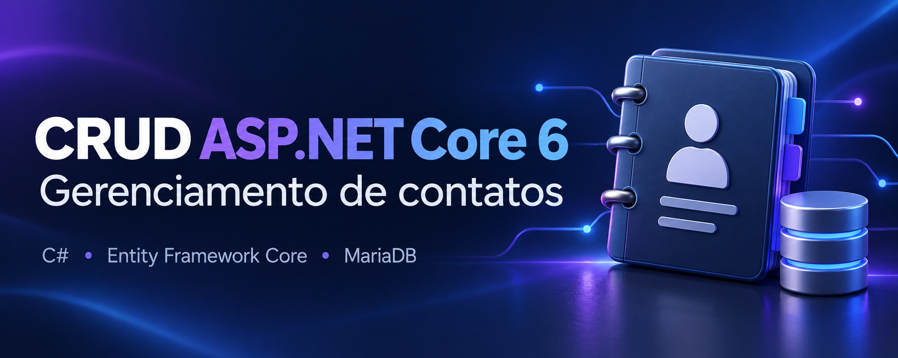
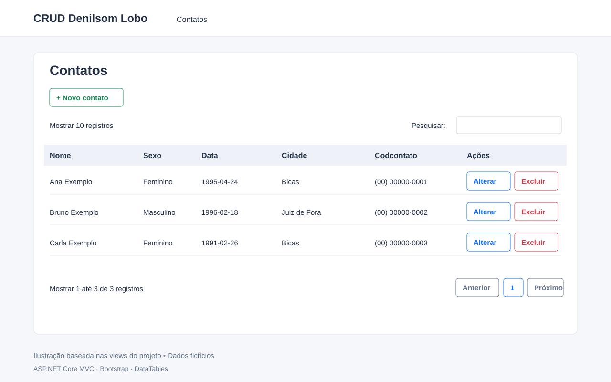
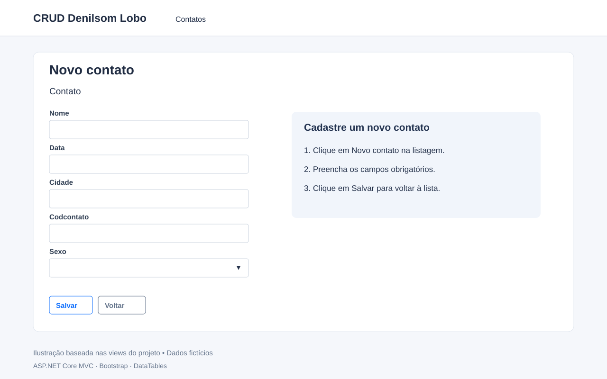
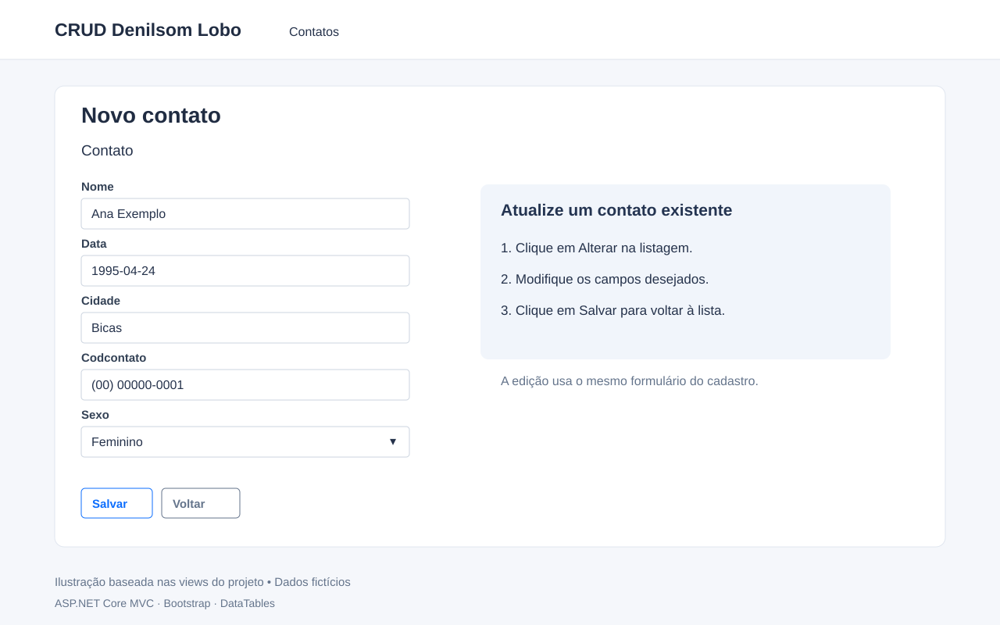

# CRUD ASP.NET Core 6 — Gerenciamento de contatos

Aplicação web desenvolvida por **Denilsom Lobo de Souza** para cadastrar, consultar, alterar e excluir contatos. O projeto utiliza ASP.NET Core MVC e Entity Framework Core para persistir os dados em MariaDB/MySQL.

## Vídeo de demonstração

▶️ **[Assista à demonstração no canal do autor](https://youtu.be/etlnZYx01RQ)**

## O que o programa faz

- **Cadastro:** registra nome, sexo, data, cidade e código de contato.
- **Consulta:** apresenta os contatos em uma tabela com pesquisa, ordenação e paginação no navegador.
- **Edição:** permite alterar um contato pelo botão **Alterar**, utilizando o mesmo formulário do cadastro.
- **Exclusão:** remove o contato após a confirmação exibida no navegador.
- **Validação:** informa os campos obrigatórios no formulário e valida os dados no servidor.

Cada contato possui um identificador gerado pelo banco. O campo `Codcontato` é textual; os dados de exemplo utilizam números de telefone.

## Imagens das funcionalidades

> As três imagens abaixo são **ilustrações baseadas nas views e no código**, com dados fictícios. Não são capturas da aplicação em execução. A interface real pode apresentar diferenças de renderização. Consulte o vídeo para ver a demonstração original.

### 1. Listagem, pesquisa e ações

A página inicial exibe os contatos e disponibiliza os botões **Novo contato**, **Alterar** e **Excluir**.



### 2. Cadastro de contato

O formulário reúne os campos obrigatórios. Após salvar um cadastro válido, a aplicação retorna à listagem.



### 3. Edição de contato

O botão **Alterar** abre o formulário com os dados do contato selecionado. O título da view original permanece “Novo contato”, inclusive durante a edição.



## Tecnologias utilizadas

| Tecnologia | Uso no projeto |
| --- | --- |
| C# / .NET 6 | Linguagem e plataforma |
| ASP.NET Core MVC | Controllers, rotas e views |
| Razor | Renderização das páginas HTML |
| Entity Framework Core 6.0.8 | Consultas, persistência e migrações |
| Pomelo.EntityFrameworkCore.MySql 6.0.2 | Integração do EF Core com MariaDB/MySQL |
| MariaDB | Banco utilizado na configuração; versão informada: 10.4.24 |
| Bootstrap | Estilos e componentes da interface |
| jQuery | Base dos scripts do navegador |
| DataTables 1.12.1 | Pesquisa, ordenação e paginação da tabela |
| jQuery Validation / Unobtrusive | Validação do formulário no navegador |
| Font Awesome | Ícones dos botões |

O projeto também referencia o provedor EF Core para SQL Server e o Swashbuckle, mas a configuração atual utiliza MariaDB/MySQL e não habilita uma interface Swagger.

## Como executar

### Pré-requisitos

- SDK .NET 6 e runtime ASP.NET Core compatível com `net6.0`.
- Visual Studio com suporte a desenvolvimento ASP.NET ou outro editor com a CLI `dotnet`.
- MariaDB/MySQL em execução.
- Acesso à internet para restaurar pacotes NuGet e carregar os recursos de CDN.

### 1. Preparar o banco

Crie o banco `CRUD_ASP_NET_6_V2` e importe [o script SQL](crud_asp_net_6_v2.sql) pelo phpMyAdmin ou outro cliente de banco.

O script inclui a estrutura das tabelas, o histórico de migração e os contatos de exemplo. O arquivo [INSERT INTO VALUES.txt](INSERT%20INTO%20VALUES.txt) contém inserções adicionais; não é necessário executá-lo para usar o dump.

### 2. Configurar a conexão

Confira a conexão em [Program.cs](CRUD_ASP_NET_6_V2/CRUD_ASP_NET_6_V2/CRUD_ASP_NET_6_V2/Program.cs). Ajuste servidor, nome do banco, usuário e senha para o seu ambiente.

### 3. Abrir no Visual Studio

Abra [CRUD_ASP_NET_6_V2.sln](CRUD_ASP_NET_6_V2/CRUD_ASP_NET_6_V2/CRUD_ASP_NET_6_V2.sln), restaure os pacotes NuGet e pressione **F5**.

### Alternativa pelo terminal

A partir da pasta que contém este README:

```powershell
cd .\CRUD_ASP_NET_6_V2\CRUD_ASP_NET_6_V2\CRUD_ASP_NET_6_V2
dotnet restore
dotnet run --launch-profile CRUD_ASP_NET_6_V2
```

O perfil do projeto configura **https://localhost:7053** e **http://localhost:5053**. Use a URL informada no terminal. A rota inicial abre a listagem de contatos.

## Estrutura do código

```text
Controllers/        Ações de navegação e operações de contatos
Data/               Contexto do Entity Framework Core
Models/             Entidade Contatos e enum Sexo
Migrations/         Migração inicial e snapshot do banco
Views/Contatos/     Listagem e formulário de cadastro/edição
Views/Shared/       Layout e scripts de validação
wwwroot/            CSS, JavaScript e bibliotecas estáticas
Program.cs          Serviços, conexão com o banco e rotas
```

## Observações sobre a versão atual

Este projeto utiliza .NET 6, que está fora de suporte. Na avaliação local, a compilação sem restauração falhou por dependências ausentes no cache NuGet; o funcionamento completo não foi validado.

Antes de disponibilizar a aplicação em produção, revise a exclusão por GET, o mapeamento do enum `Sexo`, o tratamento de registros inexistentes e a configuração de acesso ao banco. Não há autenticação configurada.

## Autor

**Denilsom Lobo de Souza**

📺 [Vídeo do projeto no YouTube](https://youtu.be/etlnZYx01RQ)

